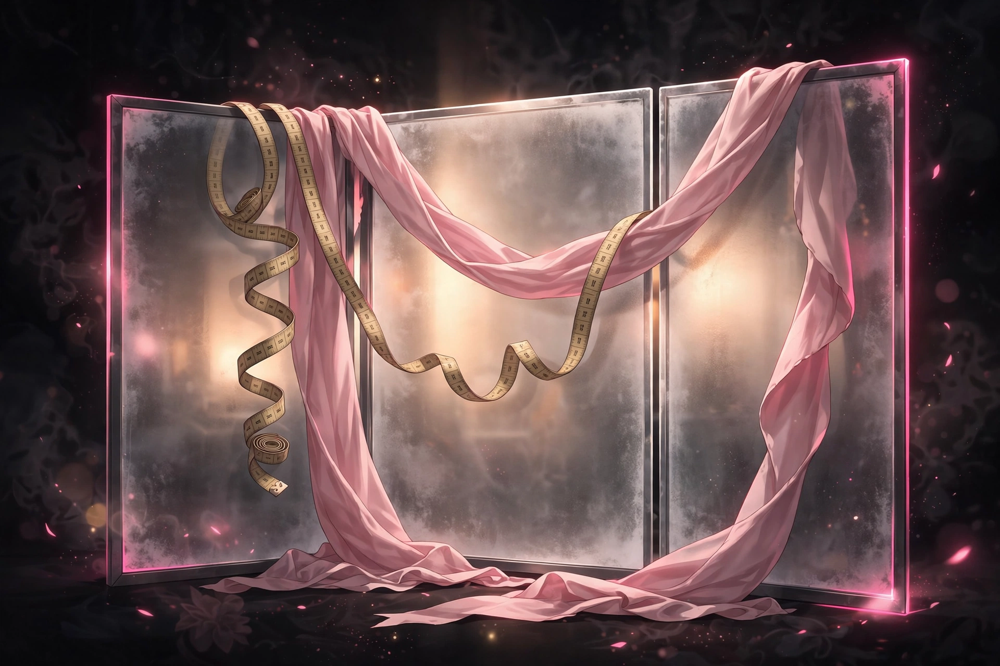

# Blushline

## 18+ — Adults Only

This game contains adult content. It is intended only for players 18 and older.

### Content notes

- Intimate body measurement: you play a fitter taking a client's readings at a series of measurement stations, including intimate stations in the final level
- Her blush and arousal are the scored responses — both rise on how truly you read her
- Every reading is reported aloud as scene text, in the clinic's matter-of-fact fitting-check style

All characters depicted are adults.

## A timing game where you take Alma's measurements at a clinic fitting and read her blush and her gaze.

<a href="https://github.com/NTRanch/blushline">GitHub</a> · <a href="https://github.com/NTRanch/blushline/blob/main/LICENSE.md">License</a> · <a href="https://ntranch.itch.io">itch.io studio page</a> · <a href="https://github.com/NTRanch/blushline/releases/tag/v1.0.0">Release</a>

## Built with

 

## What you do

You are the fitter; Alma is the client. At each measurement station, you tap as the needle crosses the true mark to take her reading, then read her gaze — toward you, away, or downcast. Every reading is reported aloud as scene text, and her blush rises on a measured response curve tied to how the fitting is going.

Three misreads end the session, so accuracy is the stakes. Each level adds stations and narrows the true mark, and her blush has to climb higher each time — from a first fitting, through a thorough check, to a final made-to-measure session where reading every intimate station's gaze truly reveals what the clinic is for.

## Features

- Three levels of rising precision: First Fitting (four stations, a wide true mark), The Thorough Check (six stations, a narrower mark), and Made to Measure (eight stations, the narrowest mark)
- A scored gaze read at every station — toward, away, or downcast — alongside the timing of each measurement
- Settings for a calm room and text size, plus your best fit per level, persist in the browser

## Media

- [Level 1 preview](../docs/previews/level-1-blushline.mp4)
- [Level 2 preview](../docs/previews/level-2-blushline.mp4)
- [Level 3 preview](../docs/previews/level-3-blushline.mp4)

## Status

**v1.0.0** — complete. Built for the Torogao Jam Program (a 14-week, one-game-per-week programme) for the Gameotron jam on itch.io. This GitHub page is the game's home while itch project slots are unavailable. To play, open `web/index.html` in a browser — it is one self-contained file and runs fully offline. Free to play.

## Credits

A Nice Thoughts Ranch game.

Made with Mojo.
